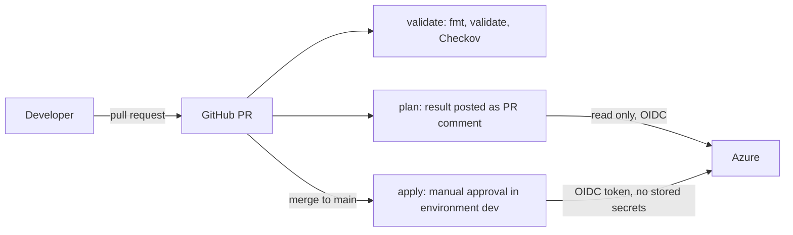
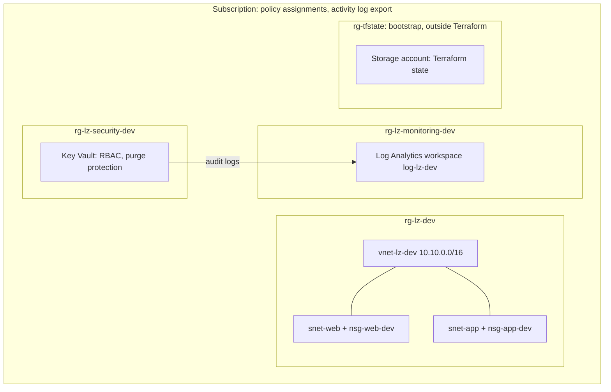

# Azure Landing Zone with Terraform

A small Azure landing zone built step by step as a hands-on learning project. Everything is defined as code with Terraform and changes only reach Azure through a pull request and a CI/CD pipeline that authenticates with OIDC, so no secrets are stored in GitHub.

**What it covers:** networking, remote state, a PR-based pipeline (validate, security scan, plan, approved apply), centralised logging, policy guardrails and a Key Vault with audit logs.

## Architecture

### Delivery pipeline



### What is deployed



The subscription Activity Log (Administrative, Security, Policy) is also exported to the Log Analytics workspace.

## Repository layout

```
environments/dev/      root module: main, variables, network, monitoring, policy, keyvault
modules/network/       VNet and subnets (for_each)
modules/monitoring/    Log Analytics workspace with retention and daily cap
modules/keyvault/      Key Vault with RBAC, soft delete and purge protection
.github/workflows/     validate.yml, plan.yml, apply.yml
```

## How a change reaches Azure

1. Create a branch and open a pull request.
2. `validate` runs `terraform fmt -check`, `terraform validate` and a Checkov scan.
3. `plan` logs in to Azure with OIDC, runs `terraform plan` and posts the result as a PR comment.
4. After merge to `main`, `apply` waits for approval in the `dev` environment, then runs `terraform apply`.

Only one apply runs at a time (concurrency group) and state is locked in the storage account backend.

## Cost

Everything here is free or close to free, by design.

| Component | Cost model | Guardrail |
|---|---|---|
| Resource groups, VNet, subnets, NSGs | Free | none needed |
| Log Analytics (PerGB2018) | Per GB ingested | 30 days retention, daily cap of 0.5 GB |
| Key Vault (Standard) | About 0.03 EUR per 10,000 operations | none needed at lab volume |
| Azure Policy | Free | none needed |
| Storage account for state | Cents per month (LRS) | none needed |
| GitHub Actions | Free on a public repository | none needed |

Rules followed: nothing billed by the hour (VMs, Bastion, Firewall, NAT Gateway, VPN Gateway, Standard public IP) is left running; a monthly budget of 20 EUR sends alerts at 50%, 80% and 100%; Cost analysis is checked weekly. A budget only alerts, it does not stop anything, so the real protection is not deploying hourly-billed resources.

## Design decisions

- **OIDC instead of secrets.** The pipeline uses an Entra ID app registration with three federated credentials (pull request, `main` branch, `dev` environment). A token lives for minutes and Azure accepts it only if the subject matches exactly.
- **Least privilege where it matters.** The pipeline identity has Contributor on the subscription, Storage Blob Data Contributor only on the state storage account, and Resource Policy Contributor to manage policies. It cannot read secrets and cannot assign roles.
- **Remote state with Entra ID only.** The state storage account has shared key access disabled, public blob access disabled, TLS 1.2 and versioning. State locking prevents concurrent applies.
- **One source of truth.** Tags come from `local.tags` and the region from `var.location`. Hand-written copies of the same value drifted twice during the build, which is why this rule exists.
- **Policy: audit first, then deny.** Custom policies take an `effect` parameter. They started in `Audit`, offenders were fixed, and the owner tag policy was then switched to `Deny` with a one-word change in a pull request. A deliberate test confirmed the block (`RequestDisallowedByPolicy`).
- **Key Vault with RBAC, soft delete and purge protection.** Access is granted with Azure roles. Data access (secrets) is a separate permission from managing the vault, so even an Owner needs a data role to read secrets.
- **Modules with `for_each` and `moved` blocks.** The network refactor changed code addresses without destroying or recreating anything.

## Accepted findings and known limitations

Checkov runs with `soft_fail: true`, so findings appear as annotations and do not block the pipeline. Every finding was reviewed. Accepted ones are suppressed in code with `#checkov:skip` and a reason.

| Finding | Decision | Reason | In production |
|---|---|---|---|
| `CKV2_AZURE_31` subnet without NSG | False positive, suppressed | The NSG is associated by the caller, outside the module | Associate inside the module or keep the documented skip |
| `CKV_AZURE_189` Key Vault public network access | Accepted | Without a private endpoint, disabling it locks out the laptop | Disable public access together with a private endpoint |
| `CKV_AZURE_109` Key Vault firewall default allow | Accepted | The home IP changes and must not be hardcoded in a public repository | `default_action = "Deny"` with explicit IP or VNet rules |
| `CKV2_AZURE_32` Key Vault private endpoint | Accepted | About 7 EUR per month breaks the cost rule | Use a private endpoint |

Other known limitations:

- The pipeline identity uses Contributor at subscription scope, which is broader than needed. A custom role would narrow it.
- Role assignments (including the data role for the Key Vault) and the state storage account are created manually (bootstrap), because the pipeline identity cannot grant roles.
- The Log Analytics workspace keeps the default internet ingestion, internet query and local authentication settings.
- The policy `Allow resources only in approved regions` uses `Indexed` mode, so it does not cover resource groups.
- `Network Watcher` is created by Azure outside Terraform and shows as non-compliant for the owner tag.
- The Microsoft Defender for Cloud default initiative is enabled on the subscription and reports non-compliant resources that this project does not address.
- Only one environment (`dev`) exists.
- GitHub Actions show Node.js 20 deprecation warnings. The action versions will be bumped.

## One-time bootstrap (manual)

These steps happen outside Terraform:

1. Storage account and container for state (Azure CLI), with a data role for the engineer.
2. Entra ID app registration, service principal, three federated credentials and role assignments.
3. GitHub repository variables (client id, tenant id, subscription id) and the `dev` environment with a required reviewer.
4. A monthly budget with email alerts.

## Lessons learned

- The OIDC subject GitHub sends contains numeric IDs (`repo:owner@ID/repo@ID:...`). Read it from the `azure/login` log instead of guessing.
- A federated credential can take a few minutes to propagate. The same error right after a correct fix usually means waiting and re-running.
- `terraform plan` does not know about Azure Policy `Deny`. A resource without required tags passes plan and fails at apply, so tags always come from `local.tags`.
- A resource created outside Terraform (the state storage account, Network Watcher) is invisible to the pipeline but visible to policy. That is how the missing tag on the state account was found.
- `Contributor` cannot write to `Microsoft.Authorization`, and `Owner` cannot read Key Vault secrets without a data role.
- Region availability is a real constraint: `westeurope` rejected new network resources on this subscription, so everything runs in `northeurope`.
- Reading and judging each scanner finding matters more than getting a clean report.

## Roadmap

- AWS equivalent of this landing zone.
- Sentinel analytics rules as code.
- Private endpoint and network rules for the Key Vault.
- Custom role for the pipeline identity.
- Switch Checkov to blocking after the remaining triage.
- A second environment and policy exemptions for Azure-managed resources.

## Requirements

Terraform 1.6 or newer (built with 1.15.8), provider `azurerm ~> 4.0`, Azure CLI, and a subscription where you can create an app registration and role assignments.
